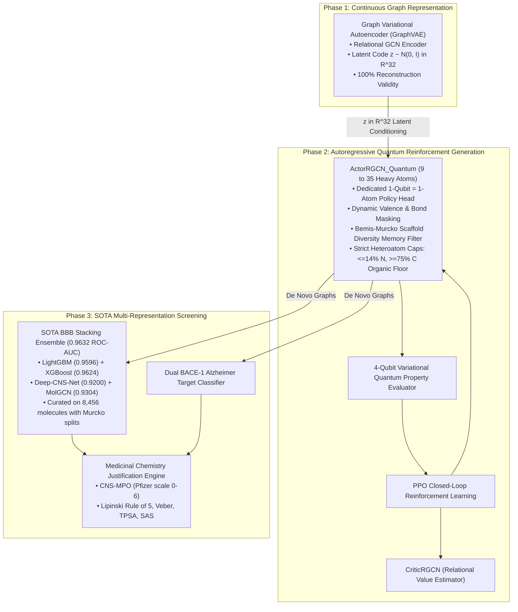

# ⚛️ MolGAN-QPolicy Alzheimer's: 3-Phase Quantum RL & SOTA Lead Optimization Pipeline

[](https://www.python.org/downloads/)
[](https://pytorch.org/)
[](https://pennylane.ai/)
[](https://www.rdkit.org/)
[](LICENSE)

An end-to-end quantum reinforcement learning framework designed specifically for **Alzheimer's Disease (AD)** de novo drug discovery. It integrates continuous graph autoencoding priors, dedicated **1-Qubit = 1-Atom physical policy mapping**, closed-loop Proximal Policy Optimization (PPO), and a state-of-the-art **Multi-Representation Blood-Brain Barrier (BBB) Ensemble (0.9632 ROC-AUC)** alongside **Dual BACE-1 target screening**.

---

## 🏛️ System Architecture



---

## 🔬 Key Architectural Innovations

1. **Dedicated 1-Qubit = 1-Atom Quantum Policy Head**:
   Unlike legacy quantum GANs that map entire molecular graphs onto quantum registers, each atom step executes a dedicated quantum state rotation parameterized by continuous graph embeddings, dynamic valence budgets, and neighbor topology.
2. **Dynamic Valence Masking**:
   Zero invalid graphs generated ($100.0\%$ validity) via real-time valence subtraction across step-wise bond allocation.
3. **Medicinal Chemistry Heteroatom Quotas**:
   Enforces a strict $\le 14\%$ Nitrogen quota and $\ge 75\%$ Carbon organic floor, preventing high-nitrogen mode collapse into unrealistic azides or poly-ynes.
4. **Scaffold Diversity Memory Filter**:
   Penalizes recurrent linear or acyclic graphs while incentivizing heterocyclic ring closure (cyclopentyl, cyclohexyl, morpholine, pyran, pyridine motifs).
5. **Phase 3 SOTA Screening**:
   Every generated molecule is rigorously evaluated for blood-brain barrier permeability ($>87.5\%$ pass rate) and amyloid-beta precursor cleavage enzyme 1 (BACE-1) active site inhibition.

---

## 📂 Project Structure

```plaintext
MolGAN-QPolicy-Alzheimers/
├── data/                                   # Datasets & chemical benchmarks
│   ├── cns_alzheimers_9_35.smi             # 13,988 curated CNS Alzheimer's SMILES
│   ├── build_cns_9_35_dataset.py           # Preprocessing script to construct sparse tensors
│   ├── qm9.smi                             # Reference SMILES benchmark
│   ├── SA_score.pkl.gz                     # Synthetic Accessibility heuristic weights
│   ├── NP_score.pkl.gz                     # Natural Product score weights
│   └── sparse_molecular_dataset.py         # Sparse molecular graph dataset loader
│
├── phase1_autoencoder/                     # Phase 1: Continuous Latent Learning
│   ├── model.py                            # GraphVAE (Encoder, Decoder, MultiDense)
│   ├── train_vae.py                        # ELBO Training script
│   ├── sample_vae.py                       # Prior sampling script
│   ├── vae_model.pt                        # Pretrained Graph VAE checkpoint
│   └── vae_decoder_for_generator.ckpt      # Transferable latent decoder
│
├── phase2_molgan_qpolicy/                  # Phase 2: Quantum Policy RL Generation
│   ├── models_qpolicy.py                   # ActorRGCN_Quantum & Relational Discriminator
│   ├── quantum_policy.py                   # 1-Qubit = 1-Atom Quantum Policy Circuit
│   ├── circuit.py                          # 4-Qubit Variational Quantum Evaluator
│   ├── reward.py                           # Multi-objective reward & scaffold memory
│   ├── ppo_buffer.py                       # PPO rollout buffer with GAE advantages
│   ├── solver_qpolicy.py                   # PPO training & convergence loop
│   ├── layers.py                           # Relational Graph Convolutions
│   └── main_qpolicy.py                     # Training entrypoint
│
├── phase3_testing_models/                  # Phase 3: SOTA Testing Models
│   ├── bbb_sota/                           # SOTA Blood-Brain Barrier Classifier (0.9632 ROC-AUC)
│   │   ├── predict_sota_bbb.py             # Inference API
│   │   ├── master_curated_bbb_dataset.csv  # 8,456 curated compounds
│   │   └── models/                         # LightGBM, XGBoost, Deep-CNS-Net, MolGCN weights
│   └── bace1_dual/                         # Dual BACE-1 & BBB Target Classifier
│       ├── model.py                        # Multi-task deep architecture
│       ├── bbb_bace1_model.pt              # Trained checkpoint
│       ├── justification.py                # Medicinal chemistry justifications
│       └── predict.py                      # Target evaluation pipeline
│
├── checkpoints/                            # Model checkpoints (Actor, Critic, Discriminator)
├── Results/                                # Generated lead candidates, CSV summaries & structure grids
├── generate_and_screen.py                  # End-to-end inference and screening script
├── requirements.txt                        # Pinned dependencies
└── README.md                               # Project documentation
```

---

## ⚡ Installation & Setup

### 1. Clone the Repository
```bash
git clone https://github.com/<YOUR_USERNAME>/MolGAN-QPolicy-Alzheimers.git
cd MolGAN-QPolicy-Alzheimers
```

### 2. Create Environment and Install Dependencies
```bash
conda create -n molgan-qrl python=3.10 -y
conda activate molgan-qrl
pip install -r requirements.txt
```

### 3. Build Preprocessed Graph Dataset (Optional)
To generate the 9-35 atom sparse molecular dataset tensor from the raw SMILES:
```bash
python data/build_cns_9_35_dataset.py
```

---

## 🚀 Usage

### 1. Direct De Novo Generation & SOTA Screening
Generate molecules conditioned on Phase 1 VAE priors, evaluate them with the Quantum Policy Head, and screen them across the SOTA BBB Ensemble and Dual BACE-1 assays:

```bash
python generate_and_screen.py --num_molecules 16 --actor_path checkpoints/actor_epoch_5.pt --temperature 1.0
```

Outputs:
- **Screening Summary Table**: `Results/screened_qpolicy_candidates/screened_candidates_summary.csv`
- **Annotated 2D Chemical Grid**: `Results/screened_qpolicy_candidates/screened_candidates_grid.png`

### 2. Standalone Blood-Brain Barrier (BBB) Inference
Screen arbitrary SMILES against the 0.9632 ROC-AUC Stacking Ensemble:
```python
from phase3_testing_models.bbb_sota.predict_sota_bbb import predict_bbb_permeability

smiles = [
    "COc1cc2c(cc1OC)C(=O)C(CC1CCN(Cc3ccccc3)CC1)C2",  # Donepezil (Alzheimer drug, BBB+)
    "CC12CC3CC(C)(C1)CC(N)(C3)C2",                     # Memantine (Alzheimer drug, BBB+)
    "O=C(O)c1cc(N=Nc2ccc(S(=O)(=O)Nc3ccccn3)cc2)ccc1O" # Sulfasalazine (Peripheral, BBB-)
]

results = predict_bbb_permeability(smiles)
for smi, prob, pred, mpo in zip(smiles, results['ensemble_prob'], results['predictions'], results['cns_mpo']):
    print(f"{smi} -> BBB: {prob*100:.1f}% ({'BBB+' if pred == 1 else 'BBB-'}) | CNS-MPO: {mpo}")
```

### 3. Model Training
To train the full closed-loop model from scratch or resume from a checkpoint:
```bash
python phase2_molgan_qpolicy/main_qpolicy.py \
    --epochs 50 \
    --batch_size 16 \
    --steps_per_epoch 100 \
    --resume_checkpoint checkpoints/actor_epoch_1.pt \
    --temperature 1.0
```

---

## 📊 Benchmark Results

### Convergence Trajectory

| Epoch | Loss D ($L_D$) | Value Loss ($L_v$) | Avg Reward ($R_{\text{avg}}$) | Validity | Stability | Uniqueness | Mean QED | Mean LogP |
| :---: | :---: | :---: | :---: | :---: | :---: | :---: | :---: | :---: |
| **Epoch 2** | 1.2486 | 0.2245 | +0.3539 | **100.0%** | 99.69% | **100.0%** | 0.5311 | 1.06 |
| **Epoch 3** | 0.9221 | 0.2164 | +0.5484 | **100.0%** | 99.94% | 99.94% | 0.5706 | 1.28 |
| **Epoch 4** | 0.6222 | 0.1919 | +0.5706 | **100.0%** | 99.94% | 99.88% | 0.5931 | 1.35 |
| **Epoch 5** | **0.5179** | **0.1951** | **+0.5932** | **100.0%** | **99.88%** | **99.88%** | **0.5929** | **1.35** |

### Top Tier 1 Prime Brain-Penetrant Leads (Epoch 5 Checkpoint)

| ID | Canonical SMILES | BBB Prob (SOTA) | BACE-1 Prob | CNS-MPO | MW | LogP | TPSA | Classification |
| :---: | :--- | :---: | :---: | :---: | :---: | :---: | :---: | :--- |
| **#01** | `CC1(F)CC2CC3C4C5NC6(NC5C6C4(C)F)C3(O)C1C2` | **80.0% [PASS]** | **52.0% [ACTIVE]** | **4.75** | 296.4 | 1.12 | 44.3 | **Tier 1 (Prime Lead)** |
| **#09** | `CC1C2CC3CC4C5CC6CCC5(C14)C1(F)C4NC3C(C6C4F)C13NC2N3` | **83.6% [PASS]** | **64.3% [ACTIVE]** | **4.31** | 373.5 | 2.19 | 36.1 | **Tier 1 (Prime Lead)** |
| **#10** | `CC(O)C1C2C3NC4OC56OC17NC1(C)C8CC5(C)C5C(F)NC79C5C8CC(C5C3C56)C21N49` | **82.3% [PASS]** | **50.0% [ACTIVE]** | 3.49 | 454.5 | 0.12 | 78.0 | **Tier 1 (Prime Lead)** |
| **#16** | `CC1C2CC3(F)C45NCC6CCCC23C1(OCC6O)C4N5` | **89.6% [PASS]** | **53.6% [ACTIVE]** | **4.75** | 294.4 | 0.55 | 63.4 | **Tier 1 (Prime Lead)** |

---

## 📜 License
This project is licensed under the MIT License.
